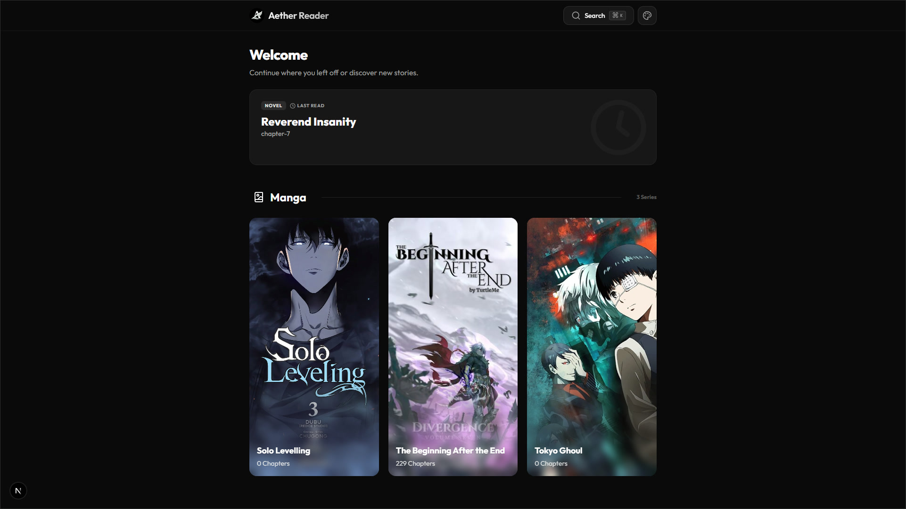
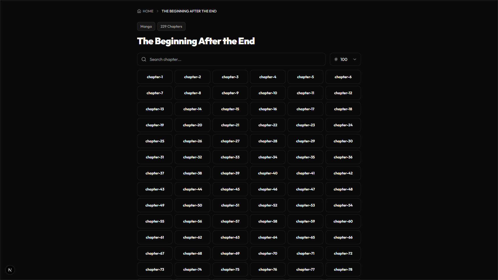

<a href="README.md">
 
</a>
<a href="README-TR.md">
 
</a>

  <br />
  <br />

<div align="center">
  
  <br />
  <br />

  <p>
    Modern, Hızlı ve Şık Bir Dijital Manga ve Roman Okuma Deneyimi
  </p>


  <p>
    <a href="#features">Özellikler</a> •
    <a href="#technologies">Teknolojiler</a> •
    <a href="#installation">Kurulum</a> •
    <a href="#how-it-works">Nasıl Çalışır?</a> •
    <a href="#license">Lisans</a> •
    <a href="#gallery">Galeri</a>
  </p>

  <br />
  <br />
</div>

## 📷 Demo Link

- [https://aether-reader.vercel.app/](https://aether-reader.vercel.app/)

## 📋 <a id="about"></a> Hakkında

**Aether Reader**, hem mangaları hem de romanları tek bir çatı altında toplayan, modern web teknolojileriyle geliştirilmiş premium bir dijital kütüphane ve okuma uygulamasıdır.

Kullanıcı dostu arayüzü, gelişmiş tema sistemi ve akıcı animasyonları ile okuma deneyiminizi en üst seviyeye çıkarmak için tasarlandı. Tüm içerikler yerel olarak yönetilir ve size maksimum hızda sunulur.

## ✨ <a id="features"></a> Özellikler

### Akıllı Kütüphane Yönetimi
- **Yerel Dosya Sistemi**: Eklediğiniz dosyaları klasör adlarından analiz ederek, herhangi bir veritabanına ihtiyaç duymadan bir kütüphane oluşturur.
- **Otomatik Kategorizasyon**: Manga ve roman içeriklerini otomatik olarak sınıflandırır ve uygun okuyucu modunda sunar.
- **Sürükleyici Kaydırma Deneyimi**: Embla Carousel desteğiyle seriler arasında hızlı ve akıcı bir şekilde gezinin.
- **Kaldığın Yerden Devam Et**: "Devam Et" butonu ile en son okuduğunuz seriye ve bölüme anında geri dönün.

### Gelişmiş Navigasyon
- **Genel Arama (Global Search)**: Herhangi bir seriye anında ulaşmanızı sağlayan modern bir arama penceresi.
- **Hızlı Bölüm Geçişleri**: Bölümler arasında akıcı geçiş ve doğrudan erişim özellikleri.
- **Duyarlı (Responsive) Tasarım**: Bilgisayardan tablete, tabletten telefona kesintisiz bir deneyim.

## 🛠️ <a id="technologies"></a> Teknolojiler

Proje, günümüzün en hızlı ve en güvenilir modern web teknolojileri kullanılarak inşa edilmiştir:

### Frontend & Framework
- **Next.js**: Web için modern ve hızlı React web çatısı
- **React 19**: Kullanıcı arayüzleri oluşturmak için güçlü kütüphane
- **Tailwind CSS**: Hızlı stil geliştirme için yardımcı sınıf tabanlı CSS kütüphanesi
- **Lucide React**: Modern ve hafif SVG ikon kütüphanesi

### UI & Deneyim
- **Embla Carousel**: Akıcı ve esnek slider/carousel kütüphanesi
- **Next Themes**: Kolay ve şık koyu/açık tema yönetimi
- **Radix UI**: Erişilebilir ve stil içermeyen temel UI bileşenleri

## 🚀 <a id="installation"></a> Kurulum

Projeyi yerel ortamınızda çalıştırmak için aşağıdaki adımları takip edebilirsiniz.

### Gereksinimler
- **Node.js**
- **NPM**

### Kurulum Adımları

1.  **Depoyu Klonlayın**
    ```bash
    git clone https://github.com/xkintaro/aether-reader.git
    cd aether-reader
    ```

2.  **Bağımlılıkları Yükleyin**
    ```bash
    npm install
    ```

3.  **Geliştirici Sunucusunu Başlatın**
    ```bash
    npm run dev
    ```

4. Tarayıcınızda `http://localhost:3000` adresine giderek uygulamaya erişin.

## ⚙️ Sistem Nasıl Çalışır? (`/contents` Klasörü) <a id="how-it-works"></a>

Aether Reader tamamen yerel bir dosya sistemi mantığıyla çalışır ve karmaşık veritabanı kurulumları gerektirmez. Kütüphanenizi oluşturmak için `contents/` klasörünü doğru şekilde yapılandırmanız yeterlidir:

### Manga Okumak İçin
Dosyalarınızı `contents/manga/` dizinine ekleyin. Aether Reader iç içe geçmiş klasör yapısını okur:
1. Ana klasör adı **Seri Başlığı** olarak alınır. (Örn: `contents/manga/Tokyo Ghoul/`)
2. Alt klasörler **Bölümler** olarak işlenir. (Örn: `contents/manga/Tokyo Ghoul/chapter-1/`)
3. Bölüm klasörü içindeki tüm popüler görsel formatları (`.jpg`, `.png`, `.webp` vb.) sırasıyla görüntülenir.

### Roman Okumak İçin
Dosyalarınızı `contents/novel/` dizinine ekleyin.
1. Ana klasör adı **Seri Başlığı** olarak alınır. (Örn: `contents/novel/Solo Leveling/`)
2. Klasörün içindeki `.txt` dosyaları otomatik olarak **Bölümler** olarak algılanır. (Örn: `contents/novel/Solo Leveling/chapter-1.txt`)

> **Kapak Görseli Ekleme:** Herhangi bir serinin (manga veya roman fark etmeksizin) ana klasörüne ekleyeceğiniz ilk görsel dosyası (örn: `cover.jpg`), o serinin kapak görseli olarak otomatik olarak kullanılır. Aksi takdirde varsayılan bir kapak atanır.

## 📄 Lisans <a id="license"></a>

Bu proje MIT Lisansı ile lisanslanmıştır. Detaylar için [LICENSE](LICENSE) dosyasını inceleyebilirsiniz.

## 🖼️ Galeri <a id="gallery"></a>



#



#


#

<p align="center">
  <sub>❤️ Developed by "Mustafa TAŞAL" (kintaro)</sub>
</p>