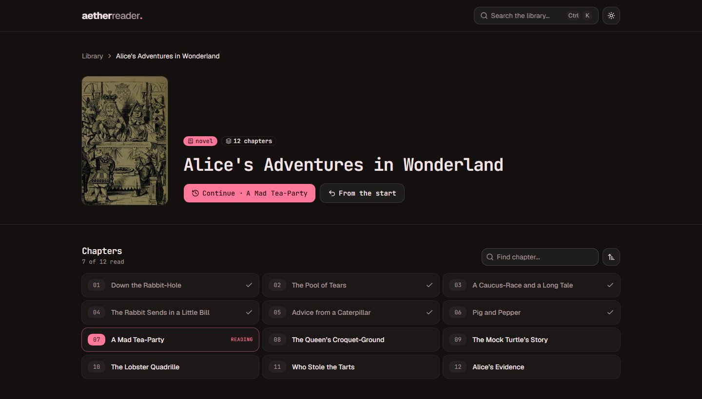

<a href="README.md">
 
</a>
<a href="README-TR.md">
 
</a>

  <br />
  <br />

<div align="center">
  
  <br />
  <br />

  <p>
    A Modern, Fast, and Elegant Digital Manga and Novel Reading Experience
  </p>


  <p>
    <a href="#features">Features</a> •
    <a href="#technologies">Technologies</a> •
    <a href="#installation">Installation</a> •
    <a href="#how-it-works">How It Works?</a> •
    <a href="#demo-content">Demo Content</a> •
    <a href="#license">License</a> •
    <a href="#gallery">Gallery</a>
  </p>

  <br />
  <br />
</div>

## 📷 Demo Link

- [https://aether-reader.vercel.app/](https://aether-reader.vercel.app/)

## 📋 <a id="about"></a> About

**Aether Reader** is a digital library and reading application that brings manga and novels together under one roof.

It reads your library straight from folders on disk — no database, no account. The interface is built with shadcn/ui and the shared [Aether Theme](https://github.com/xkintaro/aether), with a clean light and dark mode.

## ✨ <a id="features"></a> Features

### Library
- **Local File System**: Builds the library from folder names, without any database.
- **Filterable Grid**: Switch between All / Manga / Novel, filter by title, and sort by title, chapter count or reading progress.
- **Reading Progress**: Every series card shows how far you've read; finished chapters are marked on the series page.
- **Continue Reading**: Jump back to the last chapter you read from the top of the library.
- **Global Search**: Press `Ctrl + K` to search any series, with covers and keyboard navigation.

### Reader
- **Manga & Novel Modes**: Manga pages are shown as a vertical strip; novels open in a focused text view.
- **Chapter Navigation**: Previous/next buttons, a chapter picker, and `←` / `→` keyboard shortcuts.
- **Distraction-Free Header**: Hides while scrolling down and shows a reading progress bar.
- **Text Settings**: Adjustable text size and typeface (Geist / JetBrains Mono) for novels, saved in the browser.

### Design
- **Light & Dark Themes**: One-click toggle, powered by the Aether Theme tokens.
- **Responsive**: Works the same on desktop, tablet and phone.

## 🛠️ <a id="technologies"></a> Technologies

### Frontend & Framework
- **Next.js 16**: React framework with the App Router and Server Actions
- **React 19**: Library for building user interfaces
- **Tailwind CSS 4**: Utility-first CSS framework
- **TypeScript**: Type-safe JavaScript

### UI & Experience
- **shadcn/ui (base-nova)**: Accessible components built on **Base UI**
- **[@xkintaro/aether-theme](https://github.com/xkintaro/aether)**: Shared color tokens, typography and fonts (Geist + JetBrains Mono)
- **cmdk**: Command palette behind the global search
- **Next Themes**: Light/dark theme switching
- **Lucide React**: Icon library

## 🚀 <a id="installation"></a> Installation

You can follow the steps below to run the project in your local environment.

### Requirements
- **Node.js** 20 or newer
- **NPM**

### Installation Steps

1.  **Clone the Repository**
    ```bash
    git clone https://github.com/xkintaro/aether-reader.git
    cd aether-reader
    ```

2.  **Install Dependencies**
    ```bash
    npm install
    ```

3.  **Start the Development Server**
    ```bash
    npm run dev
    ```

4. Access the application by going to `http://localhost:3000` in your browser.

## ⚙️ How the System Works? (`/contents` Folder) <a id="how-it-works"></a>

Aether Reader works entirely on a local file system and does not require a database. Structure the `contents/` folder like this to create your library:

```text
contents/
├── manga/
│   └── Pepper&Carrot/              ← series title
│       ├── cover.webp              ← series cover
│       ├── 01 - Potion of Flight/  ← chapter (folder of images)
│       │   ├── 01.webp
│       │   └── 02.webp
│       └── 02 - Rainbow Potions/
└── novel/
    └── Frankenstein/               ← series title
        ├── cover.webp
        ├── 01 - Letter 1.txt       ← chapter (plain text file)
        └── 02 - Letter 2.txt
```

### For Reading Manga
Add your files to the `contents/manga/` directory:
1. The folder name is used as the **Series Title**.
2. Each subfolder is a **Chapter**.
3. Images inside a chapter (`.jpg`, `.jpeg`, `.png`, `.webp`) are shown in natural order (`2` comes before `10`).

### For Reading Novels
Add your files to the `contents/novel/` directory:
1. The folder name is used as the **Series Title**.
2. Each `.txt` file is a **Chapter**. Blank lines separate paragraphs.

### Chapter Names
- Chapters are sorted by name in natural order.
- An ordering prefix like `01 - ` is hidden in the interface, so `07 - A Mad Tea-Party` is shown as **A Mad Tea-Party**.
- Simple names like `chapter-1` also work and are shown as **chapter 1**.

> **Adding a Cover Image:** The first image file (e.g. `cover.webp`) in a series folder is used as its cover. If there is none, a default cover is shown.

## 📚 <a id="demo-content"></a> Demo Content

The repository ships with a small demo library made only of public domain and freely licensed works:

- **Manga:** *Pepper&Carrot* by David Revoy (CC BY 4.0), *Hokusai Manga* and *One Hundred Views of Mount Fuji* by Katsushika Hokusai (public domain)
- **Novels:** *Alice's Adventures in Wonderland*, *Dracula*, *Frankenstein*, *The Adventures of Sherlock Holmes*, *The War of the Worlds*, *The Wonderful Wizard of Oz* and *Treasure Island* (Project Gutenberg, public domain)

Sources, authors and licenses are listed in [contents/CREDITS.md](contents/CREDITS.md). You can delete these folders and add your own.

## 📄 License <a id="license"></a>

This project is licensed under the MIT License. You can check the [LICENSE](LICENSE) file for details. Demo content keeps its own license (see [contents/CREDITS.md](contents/CREDITS.md)).

## 🖼️ Gallery <a id="gallery"></a>


#



#


#

<p align="center">
  <sub>❤️ Developed by "Mustafa TAŞAL" (kintaro)</sub>
</p>
