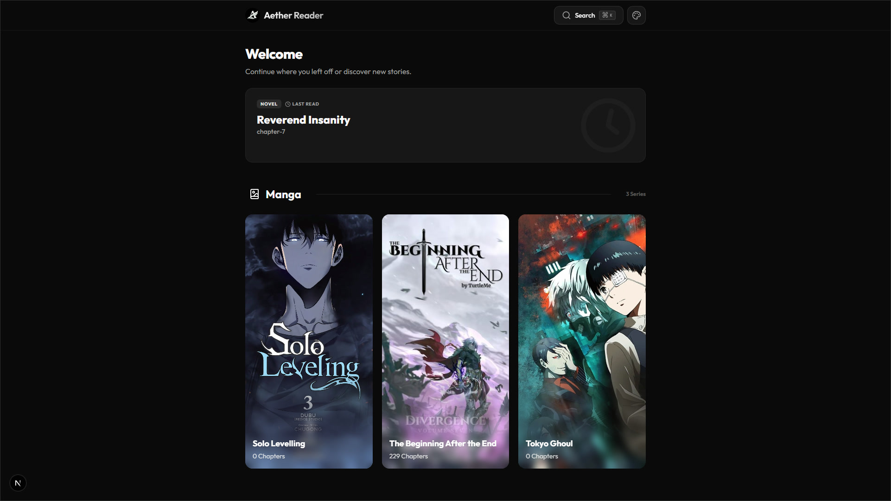

<a href="README.md">
 
</a>
<a href="README-TR.md">
 
</a>

  <br />
  <br />

<div align="center">
  
  <br />
  <br />

  <p>
    A Modern, Fast, and Elegant Digital Manga and Novel Reading Experience
  </p>


  <p>
    <a href="#features">Features</a> •
    <a href="#technologies">Technologies</a> •
    <a href="#installation">Installation</a> •
    <a href="#how-it-works">How It Works?</a> •
    <a href="#license">License</a> •
    <a href="#gallery">Gallery</a>
  </p>

  <br />
  <br />
</div>

## 📷 Demo Link

- [https://aether-reader.vercel.app/](https://aether-reader.vercel.app/)

## 📋 <a id="about"></a> About

**Aether Reader** is a premium digital library and reading application developed with modern web technologies, bringing both mangas and novels under one roof.

Designed to elevate your reading experience with its user-friendly interface, advanced theme system, and smooth animations. All content is managed locally and served to you at maximum speed.

## ✨ <a id="features"></a> Features

### Smart Library Management
- **Local File System**: Creates a library by analyzing the files you add from their folder names, without needing any database.
- **Automatic Categorization**: Automatically categorizes manga and novel content and presents them in the appropriate reader mode.
- **Slider Experience**: Navigate quickly and smoothly between series with Embla Carousel support.
- **Continue Where You Left Off**: Return instantly to the last series and chapter you read with the "Continue" button.

### Advanced Navigation
- **Global Search**: A modern search modal that allows you to reach any series instantly.
- **Fast Chapter Transitions**: Smooth navigation between chapters and direct access capabilities.
- **Responsive Design**: A seamless experience from PC to tablet, and tablet to phone.

## 🛠️ <a id="technologies"></a> Technologies

The project is built using today's fastest and most reliable modern web technologies:

### Frontend & Framework
- **Next.js**: Modern and fast React framework for the web
- **React 19**: Powerful library for building user interfaces
- **Tailwind CSS**: Utility-first CSS framework for rapid styling
- **Lucide React**: Modern and lightweight SVG icon library

### UI & Experience
- **Embla Carousel**: Smooth and flexible carousel/slider library
- **Next Themes**: Easy and elegant dark/light theme management
- **Radix UI**: Accessible and unstyled primitive UI components

## 🚀 <a id="installation"></a> Installation

You can follow the steps below to run the project in your local environment.

### Requirements
- **Node.js**
- **NPM**

### Installation Steps

1.  **Clone the Repository**
    ```bash
    git clone https://github.com/xkintaro/aether-reader.git
    cd aether-reader
    ```

2.  **Install Dependencies**
    ```bash
    npm install
    ```

3.  **Start the Development Server**
    ```bash
    npm run dev
    ```

4. Access the application by going to `http://localhost:3000` in your browser.

## ⚙️ How the System Works? (`/contents` Folder) <a id="how-it-works"></a>

Aether Reader works entirely on a local file system logic and does not require complex database setups. Simply structure the `contents/` folder correctly to create your library:

### For Reading Manga
Add your files to the `contents/manga/` directory. Aether Reader reads the nested folder structure:
1. The main folder name is taken as the **Series Title**. (e.g., `contents/manga/Tokyo Ghoul/`)
2. Subfolders are processed as **Chapters**. (e.g., `contents/manga/Tokyo Ghoul/chapter-1/`)
3. All popular image formats (`.jpg`, `.png`, `.webp`, etc.) inside the chapter folder are displayed in order.

### For Reading Novels
Add your files to the `contents/novel/` directory.
1. The main folder name is taken as the **Series Title**. (e.g., `contents/novel/Solo Leveling/`)
2. `.txt` files inside the folder are automatically detected as **Chapters**. (e.g., `contents/novel/Solo Leveling/chapter-1.txt`)

> **Adding a Cover Image:** The first image file (e.g., `cover.jpg`) you add to the main folder of any series (whether manga or novel) is automatically used as the cover image for that series. Otherwise, a default cover is assigned.

## 📄 License <a id="license"></a>

This project is licensed under the MIT License. You can check the [LICENSE](LICENSE) file for details.

## 🖼️ Gallery <a id="gallery"></a>



#


#


#

<p align="center">
  <sub>❤️ Developed by "Mustafa TAŞAL" (kintaro)</sub>
</p>