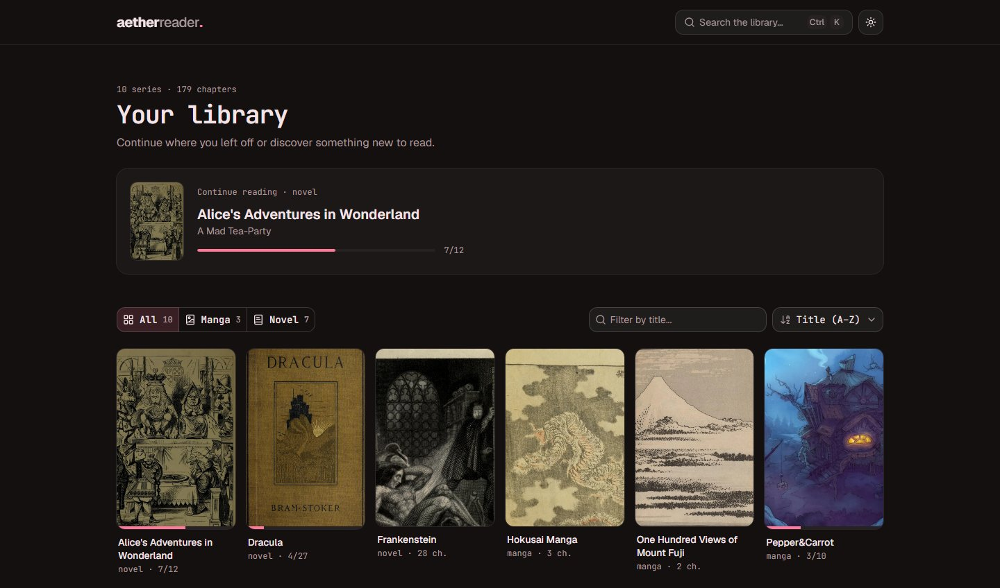
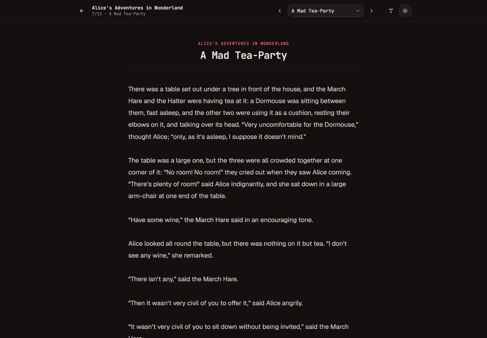

<a href="README.md">
  
</a>
<a href="README-TR.md">
  
</a>

  <br />
  <br />

<div align="center">
  
  <br />
  <br />

  <p>
     A digital library for reading manga and novels from local folders.
  </p>


  <p>
    <a href="#demo">Demo</a> •
    <a href="#info">Info</a> •
    <a href="#about">About</a> •
    <a href="#features">Features</a> •
    <a href="#tech">Tech</a> •
    <a href="#setup">Setup</a> •
    <a href="#gallery">Gallery</a> •
    <a href="#license">License</a>
  </p>

  <br />
  <br />
</div>

## <a id="demo"></a> 📷 Demo

- [https://aether-reader.vercel.app/](https://aether-reader.vercel.app/)

## <a id="info"></a> 📌 Info

The demo library in the repository is made only of public domain and freely licensed works. *Pepper&Carrot* by David Revoy is licensed under CC BY 4.0. *Hokusai Manga* and *One Hundred Views of Mount Fuji* by Katsushika Hokusai and the novels from Project Gutenberg are in the public domain. Sources, authors and licenses are listed in [contents/CREDITS.md](contents/CREDITS.md).

## <a id="about"></a> 📋 About

**Aether Reader** is a digital library and reading app that brings manga and novels together in one place. It builds the library straight from the folders in the `contents/` directory, without a database or an account.

## <a id="features"></a> ✨ Features

- **Folder-based library**: Series and chapters are read from folder and file names, without any database.
- **Filterable grid**: Switch between all, manga and novel, search by title, and sort by title, chapter count or reading progress.
- **Reading progress**: Series cards show how far you have read, and finished chapters are marked on the series page.
- **Continue reading**: Go back to the last chapter you read from the top of the library.
- **Global search**: Press `Ctrl + K` to search all series with covers and keyboard navigation.
- **Manga and novel modes**: Manga pages are shown as a vertical strip, and novels open in a focused text view.
- **Chapter navigation**: Move between chapters with the buttons, the chapter picker or the `←` and `→` keys.
- **Reader header**: The header hides while you scroll down and shows a reading progress bar.
- **Text settings**: Change the text size and typeface for novels. Your choice is saved in the browser.
- **Light and dark themes**: Switch the theme with one click.

## <a id="tech"></a> 🛠️ Tech

`Next.js` · `React` · `TypeScript` · `Tailwind CSS` · `shadcn/ui` · `Base UI` · `cmdk` · `next-themes` · `Lucide React`

## <a id="setup"></a> 🚀 Setup

### Requirements

- **Node.js** 20 or newer

### Step-by-Step Installation

1. **Clone the repository**

   ```bash
   git clone https://github.com/xkintaro/aether-reader.git
   cd aether-reader
   ```

2. **Install dependencies**

   ```bash
   npm install
   ```

3. **Start the development server**

   ```bash
   npm run dev
   ```

Open the app at [http://localhost:3000](http://localhost:3000).

### Adding Content

Create your library by structuring the `contents/` folder like this:

```text
contents/
├── manga/
│   └── Pepper&Carrot/              ← series title
│       ├── cover.webp              ← series cover
│       ├── 01 - Potion of Flight/  ← chapter, a folder of images
│       │   ├── 01.webp
│       │   └── 02.webp
│       └── 02 - Rainbow Potions/
└── novel/
    └── Frankenstein/               ← series title
        ├── cover.webp
        ├── 01 - Letter 1.txt       ← chapter, a plain text file
        └── 02 - Letter 2.txt
```

- **Manga**: Each folder in `contents/manga/` is a series and each subfolder is a chapter. Images in a chapter are `.jpg`, `.jpeg`, `.png` or `.webp` files and are shown in natural order, so `2` comes before `10`.
- **Novels**: Each folder in `contents/novel/` is a series and each `.txt` file is a chapter. Blank lines separate paragraphs.
- **Chapter names**: Chapters are sorted by name in natural order. A prefix like `01 - ` is hidden in the interface, so `07 - A Mad Tea-Party` is shown as **A Mad Tea-Party**.
- **Cover**: The first image file in a series folder is used as its cover. If there is none, a default cover is shown.

You can delete the demo folders and add your own.

## <a id="gallery"></a> 🖼️ Gallery






## <a id="license"></a> 📄 License

This project is licensed under the MIT License. See the [LICENSE](LICENSE) file for details.

#

<p align="center">
  <sub>❤️ Developed by "Mustafa TAŞAL" (kintaro)</sub>
</p>
